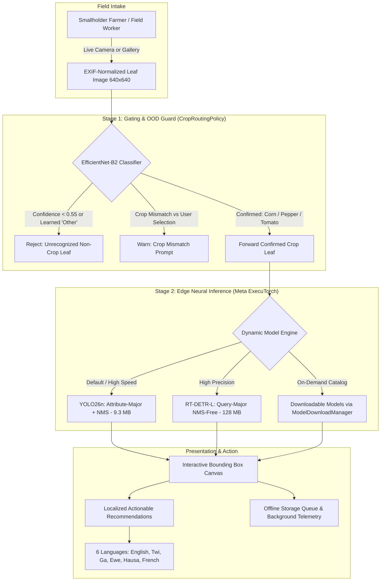

# Crop Disease Detection Mobile Application

[](#)
[](#)
[](#)
[](#)
[](#)
[](#)
[](#)

Production-grade, offline-first **Kotlin Multiplatform (Compose Multiplatform)** mobile application for real-time agricultural disease diagnosis in West African staple crops.

---

## 📖 System Overview

The **Crop Disease Detection Mobile Application** is a field-deployable diagnostic tool designed to combat crop loss among smallholder farmers in West Africa. Agricultural plant diseases reduce yields in staple crops by **30% to 50%**, while the agricultural extension officer-to-farmer ratio in Ghana exceeds **1:1,500 to 1:3,000**, leaving rural farmers without timely, expert agronomic advice.

To overcome the twin barriers of **zero cellular connectivity in rural fields** and **non-English literacy**, this application pairs on-device neural edge computing with native indigenous language localization.



### Key Capabilities

* **100% On-Device Neural Inference:** Powered by **Meta ExecuTorch 1.3.1**, running ahead-of-time (AOT) compiled `.pte` models directly on mobile silicon with zero server dependence.
* **Shared Cross-Platform Pipeline & EXIF Contract:** `DetectionPipeline` and `CropRoutingPolicy` unify two-stage gating, crop-mismatch handling, and OOD rejection across Android and iOS, paired with EXIF orientation normalization (`ImageOrientation.kt`, `ExifOrientationContract.kt`) so rotated camera captures align with bounding boxes.
* **Two-Stage Hallucination Guard:** Eliminates false alarms on weeds, soil, clothing, or unrelated leaves (e.g., cassava) through an **EfficientNet-B2** gating stage (`crop_classifier_ood.pte`).
* **Dual Bundled + On-Demand Edge Detection Engines:** Switch between **YOLO26n** (9.3 MB, fast baseline) and **RT-DETR-L** (128.5 MB, transformer accuracy of 0.345 mAP@0.5) in Settings (`ModelPicker.kt`), with extensible on-demand downloading and local storage management via `ModelDownloadManager` and platform `ModelFileStore`.
* **Indigenous Localization in 6 Languages:** Delivers culturally attuned disease names, UI strings (`composeResources/values-*`), and treatment protocols in **English**, **Twi (Akan)**, **Ga**, **Ewe**, **Hausa**, and **French**.
* **Actionable 3-Tier Agronomy:** Every diagnosis links directly to verified symptoms, zero-cost organic/cultural prevention practices, and safe chemical management guidelines (active ingredients, dilution ratios, and Pre-Harvest Intervals).
* **Offline-First Architecture & Active Learning:** Persistent local queues (`OfflineQueueStore.kt`) save field scans offline, synchronizing to Firebase (Firestore, Auth, Storage) and Cloudinary when connectivity returns, with a **Human-in-the-Loop Flagging System** for expert review.

---

## 🏛 Architecture & Technology Stack

The mobile client is engineered using a clean **Kotlin Multiplatform (KMP)** layered architecture where business logic, pipeline orchestration, localization, and presentation state are shared in `commonMain`:

```text
app/src/
├── commonMain/
│   ├── assets/benchmark/                  ← Shared benchmark reference images (corn, pepper, tomato, ood_cassava)
│   ├── composeResources/                  ← Localized string resources (values, values-tw, values-ga, values-ee, values-ha, values-fr)
│   └── kotlin/com/nkwabyte/cropdiseasedetection/
│       ├── common/
│       │   ├── data/                      ← Multi-language disease encyclopedia & advice (23 classes)
│       │   ├── helpers/ObjectDetector.kt  ← Expect declaration for edge ML runtime
│       │   ├── model/
│       │   │   ├── DetectionModelSpec.kt  ← Model catalog (YOLO26n, RT-DETR-L, Faster R-CNN) & tensor layouts
│       │   │   ├── DetectionResult.kt     ← Bounding boxes, confidence & inference metadata
│       │   │   ├── ExifOrientationContract.kt ← Cross-platform EXIF orientation contract
│       │   │   ├── SupportedCrop.kt       ← Canonical supported crops & routing enums
│       │   │   └── Benchmark*.kt          ← Benchmark image set & schema v4 result models
│       │   ├── models/
│       │   │   └── ModelDownloadManager.kt ← On-demand model weight download & storage manager
│       │   ├── pipeline/
│       │   │   ├── DetectionPipeline.kt   ← Shared two-stage inference orchestrator
│       │   │   ├── CropRoutingPolicy.kt   ← Gating, OOD rejection & crop-mismatch policy
│       │   │   ├── DetectionStateReducer.kt ← Pure UI state reducer for detection flow
│       │   │   └── ObjectDetectorEngine.kt ← Platform-agnostic inference engine interface
│       │   └── navigation/
│       │       ├── NavigationRoot.kt      ← Multiplatform navigation shell
│       │       ├── di/AppModule.kt        ← Koin dependency injection configuration
│       │       ├── routes/Routes.kt       ← Type-safe navigation routes
│       │       └── viewmodel/             ← AppViewModel, AuthViewModel, DetectionViewModel, HistoryViewModel
│       ├── data/
│       │   ├── network/CloudinaryApi.kt   ← Multiplatform image upload via Ktor
│       │   ├── repository/SyncRepository.kt ← Background cloud telemetry sync
│       │   └── storage/OfflineQueueStore.kt ← Local JSON persistence
│       └── ui/
│           ├── components/                ← Shared Material 3 components (GroupedComponents.kt, etc.)
│           ├── screens/
│           │   ├── home/                  ← HomeScreen, DetectionResultScreen, RecommendationScreen
│           │   ├── encyclopedia/          ← Offline disease reference guide
│           │   ├── history/               ← Historical diagnostic scans & filtering
│           │   ├── settings/              ← SettingsScreen & ModelPicker
│           │   └── auth/                  ← ProfileScreen & ForgotPasswordScreen
│           └── theme/                     ← Typography, shapes, and color tokens
├── commonTest/                            ← Unit tests (DetectionPipelineTest, CropRoutingPolicyTest, BenchmarkExportTest)
├── androidMain/
│   ├── assets/                            ← Compiled .pte binaries (classifier, YOLO26n, RT-DETR-L)
│   └── kotlin/com/nkwabyte/cropdiseasedetection/
│       ├── common/helpers/ObjectDetector.kt ← ExecuTorch Android AAR runtime & JNI
│       ├── common/models/ModelFileStore.android.kt ← Android model file storage
│       └── common/utils/                  ← ImageOrientation.kt (EXIF), ImageIngest.kt, BoundingBoxImage.kt
├── androidInstrumentedTest/               ← ExtendedBenchmarkHarnessTest, ImageOrientationInstrumentedTest, PipelineDeviceAcceptanceTest
└── iosMain/
    └── kotlin/com/nkwabyte/cropdiseasedetection/
        ├── common/helpers/ObjectDetector.kt ← C-Interop ExecuTorchBridge wrapper
        └── common/models/ModelFileStore.ios.kt ← iOS model file storage

iosApp/iosApp/
├── ExecuTorchBridge.h / ExecuTorchBridge.swift ← Native iOS ExecuTorch runtime & memory/benchmark telemetry
├── Views/                                 ← SwiftUI views (HomeView, SettingsView, ProfileView)
└── Localizations.json                     ← Native iOS localization strings
```

### Core Libraries & Tools

| Component | Technology | Role / Specification |
| :--- | :--- | :--- |
| **Cross-Platform Core** | Kotlin Multiplatform 2.3.0 | Single unified codebase for Android & iOS |
| **UI Framework** | Jetpack Compose Multiplatform 1.7.0 | Declarative Material 3 design system (+ SwiftUI host on iOS) |
| **Edge ML Engine** | Meta ExecuTorch 1.3.1 | Native mobile C++ runtime running Ahead-of-Time `.pte` binaries |
| **Dependency Injection** | Koin 4.0.0 | Lightweight, decoupled service locator & ViewModel provider |
| **Networking** | Ktor Client 3.0.0 (OkHttp / Darwin) | Asynchronous HTTP engine for Cloudinary & model downloads |
| **Cloud Telemetry** | GitLive Firebase 2.1.0 (Auth, Firestore, Storage) | Multiplatform authentication, telemetry & storage rules |
| **Async Image Loading** | Coil3 3.0.4 | Memory-cached image rendering |
| **Native Interop** | SKIE 0.10.14 + Kotlin C-Interop | Swift coroutines bridge and C++ ExecuTorch headers on iOS |

---

## 🧠 On-Device Edge AI Runtime (Meta ExecuTorch)

The application bundles **ExecuTorch** neural programs in the mobile asset bundle and decodes tensors dynamically via [`DetectionModelSpec.kt`](app/src/commonMain/kotlin/com/nkwabyte/cropdiseasedetection/common/model/DetectionModelSpec.kt) and platform `ObjectDetector.kt` implementations:

```kotlin
// Multi-Format Tensor Decoding Engine
when (spec.layout) {
    DetectionOutputLayout.YOLO_ATTRIBUTE_MAJOR -> {
        // YOLO26: [1, 4 + numClasses, numPredictions]
        // Boxes are (cx, cy, w, h) in pixels -> Convert to XYXY & apply Mobile NMS
        decodeYoloAttributeMajor(outputArray, spec, imageWidth, imageHeight)
    }
    DetectionOutputLayout.DETR_QUERY_MAJOR -> {
        // RT-DETR: [1, numQueries, 4 + numClasses]
        // Boxes are normalized (0..1) -> Direct thresholding (NMS-Free)
        decodeDetrQueryMajor(outputArray, spec, imageWidth, imageHeight)
    }
}
```

### Edge Models

| Model Asset | Architecture | Size | Runtime Target | Key Characteristic |
| :--- | :--- | :---: | :---: | :--- |
| `crop_classifier_ood.pte` | EfficientNet-B2 (4-class) | 29.4 MB | Stage 1 Gatekeeper | 98.74% OOD rejection |
| `crop_disease_yolo26.pte` | YOLO26n (Ultralytics) | **9.3 MB** | Stage 2 (Default) | Ultra-lightweight, 0.290 mAP@0.5 |
| `crop_disease_rtdetr.pte` | RT-DETR-L (Transformer) | **128.5 MB** | Stage 2 (Accuracy Mode) | Query-based transformer, NMS-free, 0.345 mAP@0.5 |
| `crop_disease_faster_rcnn.pte` | Faster R-CNN | On-demand | Stage 2 (Downloadable) | Managed via `ModelDownloadManager` (`ModelHosting.DOWNLOADS_ENABLED`) |

---

## 🌍 Indigenous Language Localization (6 Languages)

To democratize diagnostic AI for smallholders who are not literate in English, all 23 diseases, symptom descriptions, cultural/chemical management plans, and UI strings are localized into 6 languages:

| Language | Target Demographic | Example Localized Recommendation Content |
| :--- | :--- | :--- |
| **English** | National standard & Agronomists | *Tomato Late Blight: Dark water-soaked lesions. Apply copper hydroxide.* |
| **Twi (Akan)** | Ashanti, Eastern & Central Ghana | *Ntoma yareɛ: Nsɔnsɔne a ɛyɛ kɔkɔɔ ne tuntum. Fa aduru a ɛko tia mmoawa gu ho.* |
| **Ga** | Greater Accra coastal farming belt | *Gbele yelitshɔŋ: Baai nɔ heji kɛ tsoi nɔ bɔ. Okɛ tsofa aahu yɛ nɔ.* |
| **Ewe** | Volta Region & Cross-Border Togo | *Agblemenu dɔléle: Aŋgba ƒe vɔvɔ kple didi. Wòle be nàtsi atike nɛ kabakaba.* |
| **Hausa** | Northern Savanna & Sahelian belt | *Cututtukan ganye: Tabo mai duhu da bushewar ganye. A yi amfani da maganin feshin.* |
| **French** | Francophone West Africa | *Mildiou de la tomate: Lésions foliaires nécrotiques. Traiter au cuivre.* |

Users can switch languages instantly from the app settings or top bar without restarting the application.

---

## 📱 Core Features & User Journey

1. **Crop Selection & Capture (`HomeScreen.kt`):** Select **Corn**, **Pepper**, **Tomato**, or **Auto-Detect** to let Stage 1 classify the plant species, then capture via camera or pick from gallery with automatic EXIF orientation normalization and `640x640` preprocessing.
2. **Interactive Bounding Box Canvas (`DetectionResultScreen.kt`):**
   * **Live Confidence Floor Slider:** Dynamically filter out weak background artifacts in real time without re-running inference.
   * **Disease Chip Filters:** Tap individual disease chips (e.g., "Tomato Late Blight") to isolate specific lesions on crowded leaves.
3. **Actionable Recommendations (`RecommendationScreen.kt`):** Instant transition to culturally attuned organic, cultural, and chemical treatment guidelines.
4. **Model Management (`SettingsScreen.kt` & `ModelPicker.kt`):** Switch between bundled detectors (`YOLO26n`, `RT-DETR-L`) and manage on-demand model downloads.
5. **Human-in-the-Loop Flagging (`FlagState`):** Allows farmers and field officers to flag questionable detections with optional notes. Flagged scans synchronize to Firebase for expert agronomist review.
6. **Local History & Encyclopedia (`HistoryScreen.kt` & `EncyclopediaScreen.kt`):** Complete field library and historical scan audit log accessible with zero internet connectivity.

---

## 🧪 Testing & Mobile Benchmarking

* **Shared Unit Tests (`app/src/commonTest`):** Covers `DetectionPipelineTest`, `CropRoutingPolicyTest`, and `BenchmarkExportTest` using `FakeInferenceEngine`.
* **Android Instrumented Tests (`app/src/androidInstrumentedTest`):** Covers `ImageOrientationInstrumentedTest`, `PipelineDeviceAcceptanceTest`, and `ExtendedBenchmarkHarnessTest`.
* **Cross-Platform Benchmark Evidence:** Device runbooks, verification ledgers, and schema v4 benchmark outputs (Android Emulator, iOS Simulator, iPhone 15 Pro Max, Redmi Note 14 Pro+, Galaxy A10) are documented in [`docs/mobile-benchmark-evidence/`](docs/mobile-benchmark-evidence/).

---

## 🚀 Getting Started & Build Guide

### Prerequisites
* **Java Development Kit (JDK):** Version 21
* **Android Studio:** Ladybug (2024.2+) or newer with Android Gradle Plugin 9.4.0
* **Xcode:** 15.0+ with CocoaPods (for iOS build)
* **Local Properties:** Copy `local.properties.template` to `local.properties` and add your SDK paths and secrets.

### Build and Run Android

```bash
# Run shared unit tests
./gradlew :app:testDebugUnitTest

# Debug APK compilation
./gradlew :app:assembleDebug

# Install and run on connected Android device/emulator
./gradlew :app:installDebug
```

### Build and Run iOS

```bash
# Compile shared Kotlin framework for iOS Simulator
./gradlew :app:compileKotlinIosSimulatorArm64

# Open the Xcode workspace/project
open iosApp/iosApp.xcodeproj
```

---

## 📄 License & Attribution

This software is released under the **Apache License 2.0**.  
Dataset annotations and imagery are licensed under **Creative Commons Attribution 4.0 International (CC BY 4.0)** via Roboflow Universe and the Makerere AI Lab.
